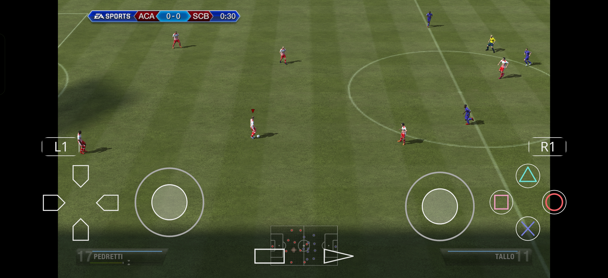
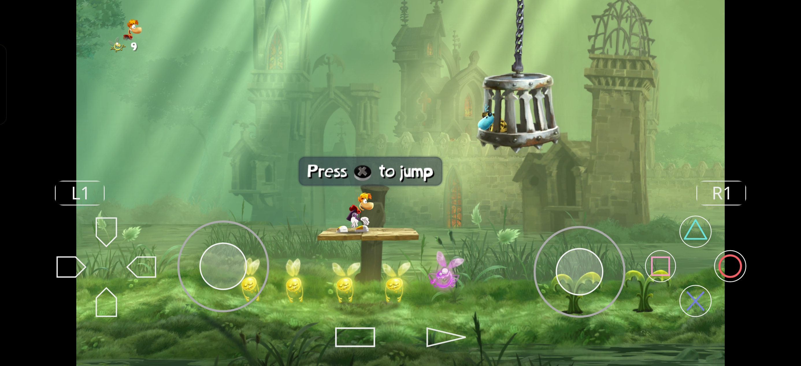
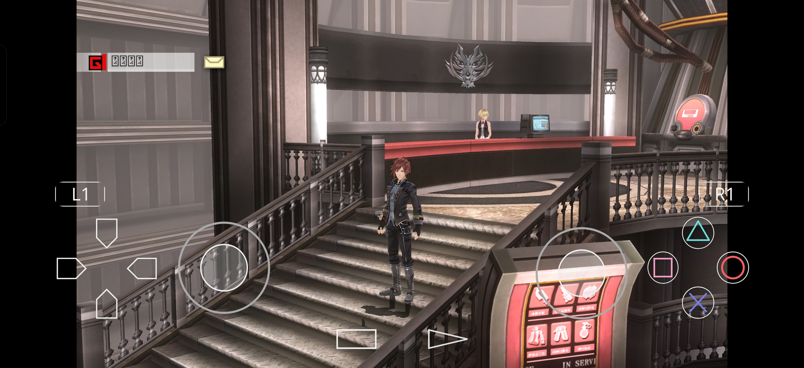
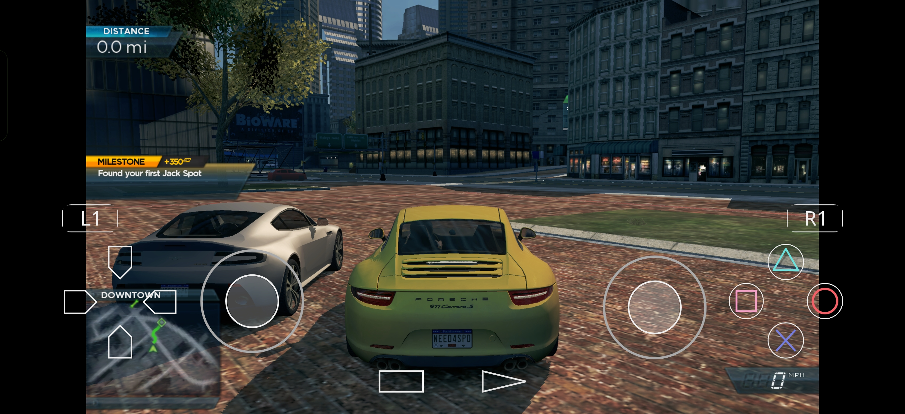

# EmuCoreV

[](https://play.google.com/store/apps/details?id=com.sbro.emucorev)
[](LICENSE)
[](https://www.patreon.com/c/emucore/membership)
[](https://discord.gg/c5EBeNRpz2)

<a href="https://play.google.com/store/apps/details?id=com.sbro.emucorev"></a>

EmuCoreV is a PlayStation Vita emulator for Android powered by **ECV**, its modified emulation core actively developed by EmuCore with its own fixes and improvements. The Android application remains **EmuCoreV**, with a custom interface, library and catalog UX, installer flows, and runtime controls.

## Highlights

- ECV native core integrated into a Kotlin + Jetpack Compose Android app
- Library and catalog screens with cover art, metadata, media, and compatibility badges
- Firmware, update, `VPK`, `ZIP`, `PKG`, `zRIF`, `RIF`, and `work.bin` install flows
- In-game overlay, per-game settings, and Android-first storage and setup flows
- App language selection and localized UI resources

## Screenshots

In-game captures running on a Snapdragon 8 Elite Gen 5 device with the Vulkan renderer:

| FIFA 15 | Rayman Legends |
| --- | --- |
|  |  |

| Dead or Alive 5 Plus | God Eater 2 |
| --- | --- |
|  |  |

| Need for Speed: Most Wanted | |
| --- | --- |
|  | |

## What This Repository Contains

This repository contains the Android application, Compose UI, JNI bridge code, ECV core source and changes, catalog assets, and supporting build tooling used by EmuCoreV. Existing technical source paths retain their upstream names where needed.

## Tech Stack

- Kotlin + Jetpack Compose
- Android DataStore
- JNI bridge to native C++
- ECV emulation core and Android integration layer
- Android NDK + CMake
- Local compatibility sync against public upstream compatibility data

## Current App Scope

EmuCoreV currently targets Android with:

- `minSdk 29` (Android 10+)
- `targetSdk 37`
- package id `com.sbro.emucorev`
- app version and build number defined in `app/build.gradle.kts`
- modified core `ECV 0.3`
- ABI `arm64-v8a`

## Building Locally

### Requirements

- Android Studio with Android SDK, NDK `29.0.14206865`, and CMake `3.22.1+`
- JDK 21 (Android Studio's bundled JBR is supported)
- Python 3 available to CMake; use `python3.path` in `local.properties` when it is not on `PATH`
- OpenSSL Android outputs prepared under `tools/openssl-test/out`
- the `third_party/vcpkg` checkout initialized

### Debug Build

```powershell
.\gradlew :app:assembleDebug
```

### Notes For Native Dependencies

- `app/build.gradle.kts` currently points `OPENSSL_ROOT_DIR` to `tools/openssl-test/out`
- `tools/build_android_openssl.sh` is the local helper used to prepare the expected OpenSSL layout
- Gradle passes the bundled `third_party/vcpkg` checkout and Android NDK to CMake automatically

## Project Structure

- `app/` Android application module
- `app/src/main/java/com/sbro/emucorev` Kotlin app code
- `app/src/main/cpp` Native bridge and ECV sources
- `app/src/main/assets` Catalog data and bundled assets
- `tools/` Local helper scripts and ignored machine-specific native build inputs

## Notes

- Firmware files, licenses, keys, and game content are not distributed with this repository.
- Use only your own legally obtained firmware and game dumps.
- Compatibility data shown in the catalog and detail screens is derived from public upstream compatibility data.
- Releases marked as "parallel" are identical to the primary build but use an alternate package ID to allow side-by-side installation.

## Credits

ECV started as a fork of the Vita3K core and is now developed by EmuCore with its own fixes and improvements.

EmuCoreV adds its own Android interface, catalog, installer flow, storage handling, and handheld-focused UX. The ECV name identifies this modified core; upstream contributors retain credit for their work, and existing copyright notices, licenses, and source history are preserved.

- [EmuCoreV and ECV source](https://github.com/sashkinbro/EmuCoreV)
- [Project license](LICENSE)

## Support

If you want to support ongoing development or join the community:

- Official website: https://emucorev.web.app
- Patreon: https://www.patreon.com/c/emucore/membership
- Discord: https://discord.gg/c5EBeNRpz2
- More apps by the author: https://play.google.com/store/apps/dev?id=7136622298887775989

<a href="https://play.google.com/store/apps/details?id=com.sbro.emucorev"></a>

## License

EmuCoreV and its ECV core include and derive from GPL-licensed upstream code, so the repository is distributed under the GNU General Public License v2.0 or later. Renaming the modified core does not change the upstream attribution or license obligations.

See [LICENSE](LICENSE) for details.
